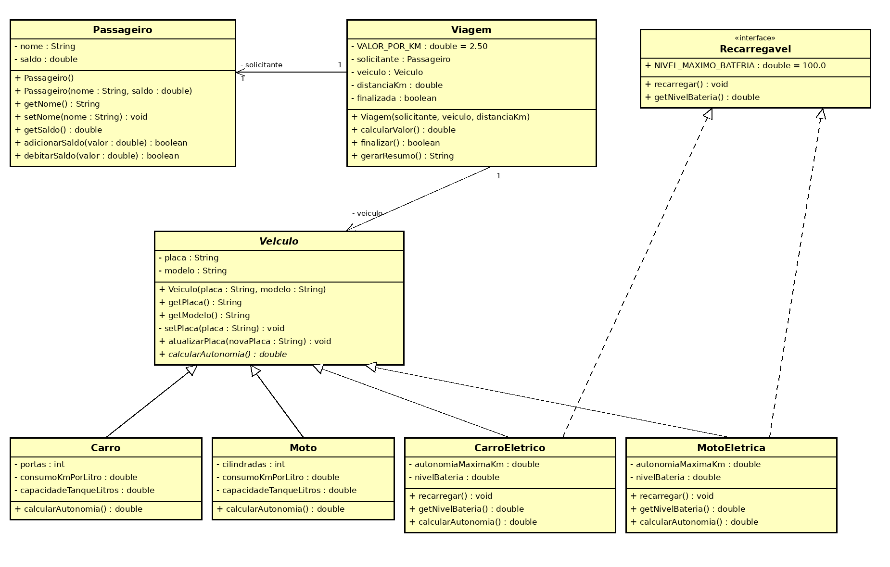

# Projeto FiapRide - [SEU NOME COMPLETO]

## 📊 Informações do Aluno

- **Nome:** [Carlos Raul Peixoto Marques]
- **RM:** [567798]
- **Turma:** [CCPR]
- **Curso:** [Ciencia da computação]

---

## 🎯 Descrição do Projeto

Este projeto é o resultado do aprendizado nas aulas 1-9 de Programação Orientada a Objetos, onde desenvolvemos o sistema **FiapRide**, uma plataforma de mobilidade que gerencia passageiros, veículos (a combustão e elétricos) e viagens. Cada aula adicionou um conceito novo ao mesmo sistema: da classe `Passageiro` simples até uma hierarquia de veículos com classe abstrata, polimorfismo e uma interface `Recarregavel`.

### Estrutura

```
src/br/com/fiapride/
├── Principal.java
└── model/
    ├── Passageiro.java
    ├── Viagem.java
    ├── Veiculo.java          (abstract)
    ├── Carro.java
    ├── Moto.java
    ├── CarroEletrico.java    (implements Recarregavel)
    ├── MotoEletrica.java     (implements Recarregavel)
    └── Recarregavel.java     (interface)
```

### Como executar

```bash
javac -d out $(find src -name "*.java")
java -cp out br.com.fiapride.Principal
```

### Diagrama de classes



---

## ✅ Checklist de Implementação

- [x] Aula 1 - Classes e Objetos
- [x] Aula 2 - Métodos
- [x] Aula 3 - Encapsulamento
- [x] Aula 4 - Construtores
- [x] Aula 5 - Associação
- [x] Aula 6 - Herança
- [x] Aula 7 - Polimorfismo
- [x] Aula 8 - Classes Abstratas
- [x] Aula 9 - Interfaces

---

## 🤔 Perguntas de Reflexão

### Aula 1 - Classes e Objetos

**Pergunta:** Por que precisamos criar uma classe `Passageiro`? Não seria mais fácil apenas criar variáveis soltas no main, como `String nomeAna = "Ana"` e `double saldoAna = 50.0`?

**Sua Resposta:**
Variáveis soltas não dizem que `nomeAna` e `saldoAna` pertencem à mesma pessoa, quem lê o código precisa adivinhar essa ligação pelo nome. Com 1 milhão de usuários eu teria 2 milhões de variáveis (`nomeBruno`, `saldoBruno`...), sem como percorrê-las num laço, passá-las para um método ou guardá-las numa lista. A classe `Passageiro` funciona como um molde: defino uma vez quais dados e comportamentos um passageiro tem e crio quantos objetos eu precisar com `new Passageiro()`. Além disso, se amanhã o FiapRide precisar de um novo dado (por exemplo, telefone), eu altero em um único lugar, em vez de criar uma variável nova para cada usuário.

---

### Aula 2 - Métodos

**Pergunta:** Se podemos fazer `passageiro.saldo = passageiro.saldo + 100` diretamente, por que criar `adicionarSaldo(valor)`? Quais seriam os riscos para a startup se qualquer programador alterasse o saldo diretamente?

**Sua Resposta:**
O método concentra a regra de negócio em um só lugar. No meu `adicionarSaldo`, recusei valores menores ou iguais a zero; com a conta feita direto, qualquer programador poderia somar `-5000` (um desconto indevido), `0`, ou esquecer de registrar a recarga. Se a regra mudar (por exemplo, limite máximo de recarga ou log para auditoria), mudo o método uma vez, e não em cada lugar do sistema que mexia no saldo. Para uma startup de mobilidade isso é dinheiro de verdade: saldo errado significa prejuízo, fraude e perda de confiança dos usuários.

---

### Aula 3 - Encapsulamento

**Pergunta:** Os atributos são `private`, mas `getSaldo()` e `getNome()` são `public`. Por que é seguro deixar o `get` público, mas perigoso deixar o atributo original público? (Cópia vs. original do documento.)

**Sua Resposta:**
O `get` só devolve o valor para leitura, é como entregar uma cópia do documento: a pessoa pode olhar, mas se rasurar a cópia o original continua intacto. Com o atributo público, eu entrego o original e qualquer um pode escrever `passageiro.saldo = 1000000`, pulando todas as validações. Com o atributo privado, toda alteração obrigatoriamente passa por métodos meus (`adicionarSaldo`, `debitarSaldo`, `setNome`), onde eu garanto as regras. No projeto, por exemplo, nem criei `setSaldo`: o saldo só muda por regras de negócio.

---

### Aula 4 - Construtores

**Pergunta:** Na classe `Veiculo`, não criamos `setModelo()` e o `setPlaca()` é privado, com um `atualizarPlaca()` público. Por que é um erro gravíssimo gerar Getters e Setters de tudo automaticamente? Como essas decisões protegem o sistema?

**Sua Resposta:**
Gerar getters e setters para tudo é o mesmo que deixar os atributos públicos com um disfarce: qualquer campo passa a poder ser alterado por qualquer parte do sistema, sem pensar se isso faz sentido no mundo real. O modelo de um carro não muda fisicamente, então ele é `final` e só é definido no construtor: sem `setModelo`, é impossível "transformar" um Onix em outro carro por engano ou fraude. Já a placa pode mudar, mas na vida real isso é um processo oficial (Detran), não editar um campo. Por isso o `setPlaca` é privado (valida o formato e só a própria classe usa) e o `atualizarPlaca` é o único caminho público, representando esse processo e deixando o ponto ideal para futuras regras e registros. Assim, o objeto nunca fica num estado inválido, e cada alteração tem um motivo claro de negócio.

---

### Aula 5 - Associação

**Pergunta:** No construtor da `Viagem` exigimos o objeto inteiro (`Passageiro solicitante`). Se o resumo só precisa imprimir o nome, não seria mais leve pedir apenas a `String nomeDoPassageiro`?

**Sua Resposta:**
Seria mais leve, mas deixaria a `Viagem` incapaz de executar o que importa para o negócio. Ao finalizar, a viagem precisa cobrar o passageiro: no meu código, `finalizar()` chama `solicitante.debitarSaldo(calcularValor())`. Com apenas a String "Ana Silva", a viagem só conheceria um texto, sem nenhuma forma de mexer no dinheiro dela (e dois passageiros com o mesmo nome seriam indistinguíveis). Guardar o objeto inteiro representa a relação real TEM-UM: a viagem tem um passageiro, com todos os dados e comportamentos dele. Também evita duplicar informação, porque o nome continua vivendo em um só lugar, no `Passageiro`.

---

### Aula 6 - Herança

**Pergunta:** A mãe `Veiculo` tem `placa` e `modelo` como `private`. Quando `Carro` herda, o código dentro dele NÃO consegue fazer `this.placa = "ABC"`. Por que o Java não deixa a filha alterar as variáveis privadas da mãe diretamente? Qual princípio isso protege?

**Sua Resposta:**
Isso protege o **encapsulamento**. Herdar significa ser um tipo de `Veiculo`, mas não significa ganhar acesso livre aos detalhes internos dele. Se a filha pudesse mexer direto na placa, ela pularia a validação do formato que a mãe faz, e cada nova subclasse (`Carro`, `Moto`, `CarroEletrico`...) poderia quebrar a regra de um jeito diferente. Do jeito que está, a filha precisa usar o construtor da mãe via `super(placa, modelo)` ou os métodos públicos, e a mãe continua sendo a única responsável por manter seus dados consistentes. Assim eu posso mudar a implementação interna de `Veiculo` sem quebrar nenhuma filha.

---

### Aula 7 - Polimorfismo

**Pergunta:** No loop `for (Veiculo veiculo : frota)`, a variável é do tipo genérico `Veiculo`. Se esquecêssemos de criar `calcularAutonomia()` na classe mãe, conseguiríamos chamá-lo no loop, mesmo existindo em `Carro` e `Moto`? Por que o contrato precisa existir na base da hierarquia?

**Sua Resposta:**
Não conseguiríamos: o código não compila. O Java verifica em tempo de compilação o tipo da *variável* (`Veiculo`), não o do objeto real, e se `Veiculo` não declara `calcularAutonomia()`, o compilador não tem como garantir que o método existe. É na classe mãe que se define o contrato ("todo veículo sabe calcular sua autonomia"); com isso o laço pode tratar a frota inteira de forma igual, e na hora de executar o Java escolhe a versão certa do método conforme o objeto real (Carro, Moto, CarroEletrico...). Sem o contrato eu precisaria de `if (v instanceof Carro)`, `else if (v instanceof Moto)`..., e cada veículo novo exigiria alterar o laço.

---

### Aula 8 - Classes Abstratas

**Pergunta:** Faz sentido existir um objeto que é APENAS "Veículo"? Por que precisamos dizer EXPLICITAMENTE ao Java que `Veiculo` é `abstract`? Qual o risco se esquecermos?

**Sua Resposta:**
No mundo real ninguém compra "um veículo" genérico: sempre é um carro, uma moto, um caminhão. Mas o Java não consegue deduzir isso sozinho, porque para ele toda classe é "instanciável" até o programador dizer o contrário: a palavra `abstract` é a minha decisão de design escrita no código. Se eu esquecesse, alguém poderia fazer `new Veiculo(...)` e criar um objeto incompleto, sem fórmula de autonomia (no estágio da aula 7 ele retornava 0.0, um valor enganoso) e sem sentido para o negócio. Com `abstract`, o compilador impede isso e ainda me obriga a implementar `calcularAutonomia()` em cada filha, então nenhuma filha "esquece" a regra.

---

### Aula 9 - Interfaces

**Pergunta:** Por que Java permite herança simples (apenas uma mãe), mas múltipla implementação de interfaces? O que aconteceria se `CarroEletrico` herdasse de `Veiculo` E de `Bateria` e ambas tivessem `ligar()`? Como as interfaces resolvem?

**Sua Resposta:**
Com herança múltipla de classes surge o problema do "diamante": se as duas mães tiverem `ligar()` com código diferente, o Java não saberia qual versão herdar, e ainda haveria conflito entre atributos e construtores. Por isso o Java permite só uma classe mãe. Interface, por outro lado, define apenas **o que** fazer (um contrato), sem estado nem implementação própria do método, então não há código conflitante: a classe que implementa é obrigada a escrever o seu próprio `ligar()` e resolve a ambiguidade. No meu projeto, `CarroEletrico` herda de `Veiculo` (o que ele *é*) e implementa `Recarregavel` (o que ele *sabe fazer*), e posso adicionar quantos contratos precisar sem ambiguidade.

---

## 🚀 Desafios Técnicos Implementados

### Desafio Pessoal (Seu Projeto)

**Qual foi o domínio que você escolheu para seu projeto pessoal?**
[PREENCHER: o domínio do seu projeto pessoal, ex: Biblioteca, Playlist de Música, PetShop]

**Quais classes você criou?**
[PREENCHER: liste as classes do seu projeto pessoal]

**Qual foi o maior desafio técnico que você enfrentou?**
[PREENCHER: descreva, com suas palavras, o desafio e como resolveu - 10-15 linhas]

---

## 🎓 Conclusão

**O que você aprendeu nestas 9 aulas?**
[PREENCHER: sua reflexão final]

**Qual conceito foi mais difícil de entender?**
[PREENCHER: qual conceito e como você superou a dificuldade]

**O que você melhoraria no seu projeto se pudesse refazer?**
[PREENCHER: reflexão crítica sobre seu código. Ideias reais do FiapRide: guardar o histórico de viagens do passageiro, calcular o valor por tipo de veículo, usar `enum` para o status da viagem, criar testes automatizados]
